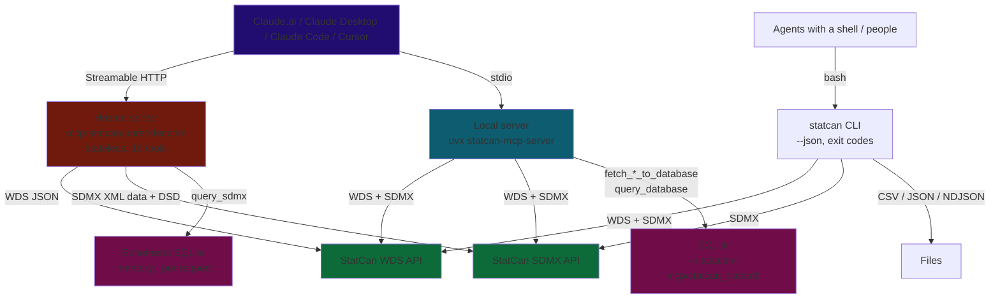

# Implementation Status & Roadmap

*Updated October 24, 2026 · current release v0.12.0 · tracking issue [#75](https://github.com/Aryan-Jhaveri/mcp-statcan/issues/75)*

---

## What's Shipped

### v0.12.0 — Correct SDMX data: XML instead of SDMX-JSON (Oct 2026) · [#90](https://github.com/Aryan-Jhaveri/mcp-statcan/issues/90)

StatCan's SDMX-JSON encodes series keys and attribute values as indices, and those indices are wrong in many responses. Data is now read as **structure-specific SDMX-ML**, where codes and attributes are inline on each `<Series>`/`<Obs>`. Rows are labelled from the table's DSD codelists.

- **Fixed:** wildcard keys returned a partial, collapsed set. This was the long-documented "sparse sample" and was a decoding artifact, not a StatCan limit. `.2` on CPI now returns all 30 geographies (JSON: 3), and the NOC wildcard on `98100452` returns 308 labelled series.
- **Fixed:** `VECTOR_ID`, `DGUID`, `UOM` and `NB_DECIMAL` landed on the wrong rows, in single-series responses too.
- **Fixed:** wrong Geography labels on OR keys, and single-period monthly data labelled with the next year.
- `src/util/sdmx_xml.py` (`flatten_sdmx_xml`, `parse_dsd_labels`, `dataflow_id`). DSD ids are normalized, because the DSD writes `Occupation_-_Minor` where the data writes `Occupation___Minor`.
- `fetch_sdmx_rows` / `fetch_sdmx_vector_rows` fetch data and the DSD concurrently. The DSD is cached for an hour (`fetch_structure_xml`) and shared with `get_sdmx_structure` and `get_sdmx_key_for_dimension`.
- Row shape is unchanged. `_series_key` is now the real SDMX key (e.g. `2.2`).
- Removed: `util/sdmx_json.py`, `_fix_or_series_keys`, `SDMX_JSON_ACCEPT`.
- Guidance updated: wildcards return every member *including totals*. Use leaf codes from `get_sdmx_key_for_dimension` for sums and rankings, and `query_sdmx` for large wildcards.

### v0.11.0 — Agent-native `statcan` CLI (Oct 2026) · [#72](https://github.com/Aryan-Jhaveri/mcp-statcan/issues/72)

- `--json` / `STATCAN_OUTPUT=json`: one success envelope on stdout; on failure, `{ok:false, error:{code, exit_code, message, hint}}` on stderr.
- Stable exit codes: 0 ok · 1 error · 2 usage · 3 not_found · 4 upstream_rejected · 5 upstream_unavailable (retryable) · 6 empty.
- `download`/`vector` envelopes carry `source_url`, `period_range` and `series_count`, so an agent that writes to a file never has to read it back. `metadata --json` gives member IDs, parent IDs and a `key_template`.
- `statcan describe` prints commands, flags, exit codes and envelopes as JSON. `--format ndjson` added.
- Fixed: CSV crash when rows have different attributes (columns are now the union across rows), and CLI frequency labels (StatCan codes: 12 = Annual, 6 = Monthly, not periods per year).
- Terminal recordings (`assets/cli-*.gif`, made with VHS from `assets/tapes/`) in the README and landing page.

### v0.10.0 — Structured tool output (Oct 2026) · [#70](https://github.com/Aryan-Jhaveri/mcp-statcan/issues/70)

- `ToolRegistry.tool(output_model=..., meta=..., annotations=...)` publishes `outputSchema`, `_meta` and `ToolAnnotations`. Tools with a schema return `structuredContent` alongside the JSON text.
- All 7 SDMX tools have output models. Read tools carry `readOnlyHint`; `fetch_sdmx_to_database` carries `destructiveHint`.
- `{"error": ...}` results are sent with `isError: true`.
- Compact JSON text results: 26–40% fewer characters.
- Tests run tools through the SDK's in-memory `Client`, so real client-side schema validation runs.

### v0.9.0 — `query_sdmx`: server-side SQL for hosted users (Oct 2026) · [#80](https://github.com/Aryan-Jhaveri/mcp-statcan/issues/80)

- Fetches observations (no 500-row cap), loads them into a per-request in-memory SQLite table `data`, runs one read-only query and returns only the result. Registered in **stdio and HTTP** mode.
- `src/db/ephemeral.py`, hardened per [sqlite.org untrusted-SQL guidance](https://sqlite.org/security.html) and Datasette's approach:
  - authorizer allowing only SELECT/READ/FUNCTION/RECURSIVE
  - `query_only`, `trusted_schema=OFF`, `SQLITE_DBCONFIG_DEFENSIVE`
  - lowered `sqlite3_limit()` values
  - 2 s progress-handler timeout
  - at most 4 concurrent queries
- Research notes: `docs/in-memory-query-research.md` (local).

### v0.8.0 — `fetch_sdmx_to_database` (Oct 2026) · [#64](https://github.com/Aryan-Jhaveri/mcp-statcan/issues/64)

- Stores a full SDMX slice in SQLite without passing rows through the model. Values are stored as REAL.
- `create_table_from_data` infers each column's type from its first non-null value.

### v0.7.x — HTTP hardening, CI/CD, SDK v2 (Apr–Sep 2026)

- **mcp-python-sdk v2** migration (v0.7.17, #61)
- `statcan download` requires `--key` (v0.7.16, #57)
- **OAuth 2.1/PKCE** (auto-approved) so the Claude.ai web connector routes tool calls (v0.7.15, #48)
- 307 redirect fix on `POST /mcp` (v0.7.14, #45)
- **Removed the SDMX CSV proxy** (`/files/sdmx/...`) and `download_csv` mode (v0.7.13, #40)
- 2026-04 security audit fixes (v0.7.11, #34); prompt-injection and path-traversal mitigations in prompt templates (v0.6.4)
- Tool-level request logging, `/.well-known/mcp.json`, `/robots.txt` (v0.7.6, #20)
- CI: auto patch-bump on push to `main`, PyPI + MCP Registry publish, landing announcement workflow, GitHub Pages `index.html` regeneration from `src/landing.py`

### v0.6.0 — `statcan` CLI (Apr 2026)

- `search`, `metadata`, `download`, `vector`, `codeset`. Typer + Rich; data on stdout, messages on stderr.
- MCP prompts reworked to teach CLI/script workflows for Claude Code and tool workflows for Claude.ai.

### v0.5.0 and earlier — Foundation (Feb–Apr 2026)

- SDMX tools: `get_sdmx_structure`, `get_sdmx_data`, `get_sdmx_rows`, `get_sdmx_vector_data`, `get_sdmx_key_for_dimension`
- MCP prompts (`statcan-data-lookup`, `sdmx-key-builder`, …) in stdio and HTTP mode
- Streamable HTTP transport (stateless) deployed at `mcp-statcan.onrender.com`; stdio for local clients
- WDS discovery, metadata, series resolution, change detection; vector tools
- SQLite layer (`~/.statcan-mcp/statcan_data.db`, `--db-path` / `STATCAN_DB_FILE`); composite tools `fetch_vectors_to_database`, `store_cube_metadata`
- `ToolRegistry` decorator → MCP Tool schema; 1-hour TTL cache for the cube list

---

## Known Issues & Constraints

| Issue | Detail |
|---|---|
| `lastNObservations` + `startPeriod`/`endPeriod` → 406 | StatCan rejects the combination; enforced with a `ValueError` in all SDMX data paths and as a usage error (exit 2) in the CLI |
| Wildcards include totals | `.` returns every member, including totals and parent aggregates. Summing or ranking over them double-counts; use leaf codes (`get_sdmx_key_for_dimension`) |
| `get_sdmx_data` caps inline rows at 500 | By design, to protect context. Use `query_sdmx` (hosted) or `fetch_sdmx_to_database` (local) for larger slices |
| No per-query heap limit in `query_sdmx` | Python's `sqlite3` doesn't expose `sqlite3_hard_heap_limit64`. Mitigated by the 50k fetched-row cap, `SQLITE_LIMIT_LENGTH`, the 2 s timeout and the 4-query concurrency cap |
| Columns from the first row in `query_sdmx` / `create_table_from_data` | Attributes absent from row 1 are dropped from the table. Rare with XML data; fixed properly by the canonical schema (#65) |
| SSL verification on broken trust stores | On by default; `STATCAN_VERIFY_SSL=false` disables it |
| `search_cubes_by_title`, `get_series_info` have no `outputSchema` | They return either a list or a dict; `structuredContent` must be an object. Needs a return-shape change |
| Typed output is sent twice on the wire | Text + `structuredContent`, per the spec's backward-compatibility guidance. Watch whether any host feeds both to the model |

---

## What's Next

Order from the tracking issue [#75](https://github.com/Aryan-Jhaveri/mcp-statcan/issues/75):

1. **[#65](https://github.com/Aryan-Jhaveri/mcp-statcan/issues/65) Canonical `series` / `observations` schema.** One long-format store with provenance (`product_id`, `vector_id`, `release_time`, `fetched_at`) and upserts, replacing per-call tables with first-row type inference. Now safe to do, since attribute values are correct (#90). Introduce a small storage interface at the same time so the engine is swappable.
2. **[#68](https://github.com/Aryan-Jhaveri/mcp-statcan/issues/68) DuckDB as an optional backend** for stdio and the CLI (`pip install statcan-mcp-server[duckdb]`), separate branch. Not for hosted persistence. Query CSV/Parquet in place. Needs `enable_external_access=false`, `lock_configuration=true` and a watchdog timeout if it ever runs untrusted SQL.
3. **[#71](https://github.com/Aryan-Jhaveri/mcp-statcan/issues/71) MCP Apps (TypeScript `ui://` views).** Unblocked by #70: the Python server only needs to serve the bundled HTML resource and set `_meta.ui.resourceUri`. Candidates are a series chart/table, an SDMX key builder over `get_sdmx_structure`, and search results. DuckDB-WASM in the iframe is an option (verify host CSP first).
4. **[#69](https://github.com/Aryan-Jhaveri/mcp-statcan/issues/69) HTTP-mode data handoff.** Short-lived download links / `resource_link` for large slices.
5. **[#66](https://github.com/Aryan-Jhaveri/mcp-statcan/issues/66) Cache-aware refresh**, **[#67](https://github.com/Aryan-Jhaveri/mcp-statcan/issues/67) DB lifecycle**, **[#73](https://github.com/Aryan-Jhaveri/mcp-statcan/issues/73) shared CLI + MCP storage** (`statcan query`, `--to-db`). All build on #65.
6. **[#74](https://github.com/Aryan-Jhaveri/mcp-statcan/issues/74) TUI explorer.** Low priority; only useful as a human → agent handoff that prints a reproducible command.

Decided against: **GraphQL**. Upstream is REST and the consumers are LLMs calling MCP tools; field selection is covered by `summary=True`, SDMX keys, composite tools and `outputSchema`.

---

## Backlog

### Quality
- [ ] Output schemas for `search_cubes_by_title` / `get_series_info` (normalize return shape)
- [ ] Per-query memory cap for `query_sdmx` on hosted (process-wide `PRAGMA hard_heap_limit` in HTTP mode, or DuckDB `memory_limit`)
- [ ] Retire or fix local `bump-version.sh` (it rewrites the first `vX.Y.Z` in `landing.py`, which is now an announcement; CI bumps don't touch `landing.py`)
- [ ] CI linting (ruff + mypy)
- [ ] Remaining test targets from `CLAUDE.md`: `coordinate`, `sql_helpers`, `cache`, `db` layer

### Distribution
- [ ] Smithery.ai listing; `awesome-mcp-servers`, PulseMCP
- [ ] Multi-client config snippets (Cursor, VS Code, Windsurf)
- [ ] Dockerfile

### Exploratory
- [ ] Release-aware caching aligned to StatCan's 8:30 AM ET publication cadence (pairs with #66)
- [ ] A2A + MCP multi-agent exploration

---

## Architecture & Data Flow



### Mode Comparison

| | Hosted HTTP (Render) | Local stdio | `statcan` CLI |
|---|---|---|---|
| Users | Claude.ai web, API, Cursor | Claude Desktop, Claude Code | People, agents with bash |
| SDMX + WDS tools | Yes | Yes | `download`, `vector`, `metadata`, `search`, `codeset` |
| Server-side SQL | `query_sdmx` (ephemeral) | `query_sdmx` + persistent `query_database` | — (planned: `statcan query`, #73) |
| Persistent storage | No | SQLite | Files |
| Structured output | `outputSchema` + `structuredContent` | Same | `--json` envelopes + exit codes |
| MCP Prompts | Yes | Yes | — |

### Data path (SDMX)

```
fetch_sdmx_rows(productId, key, period)            ─┐
  ├─ GET data/DF_{pid}/{key}   Accept: structure-specific XML
  └─ fetch_structure_xml(pid)  (DSD, cached 1 h)     ├─ asyncio.gather
flatten_sdmx_xml(data, parse_dsd_labels(dsd))      ─┘
  → rows: {<dimension labels>, _series_key, period, value, <attributes>}
     used by get_sdmx_data / get_sdmx_rows / query_sdmx / fetch_sdmx_to_database / statcan download
```
